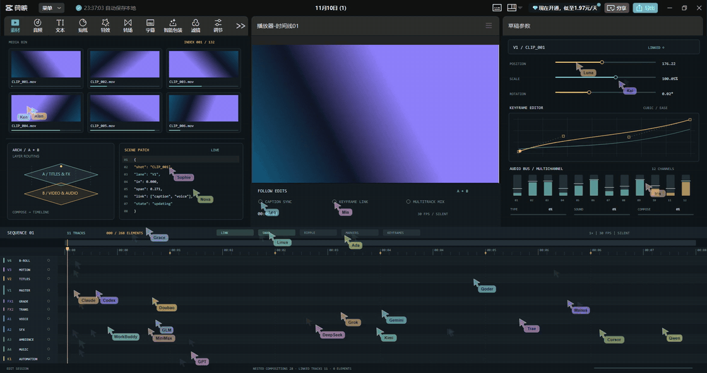
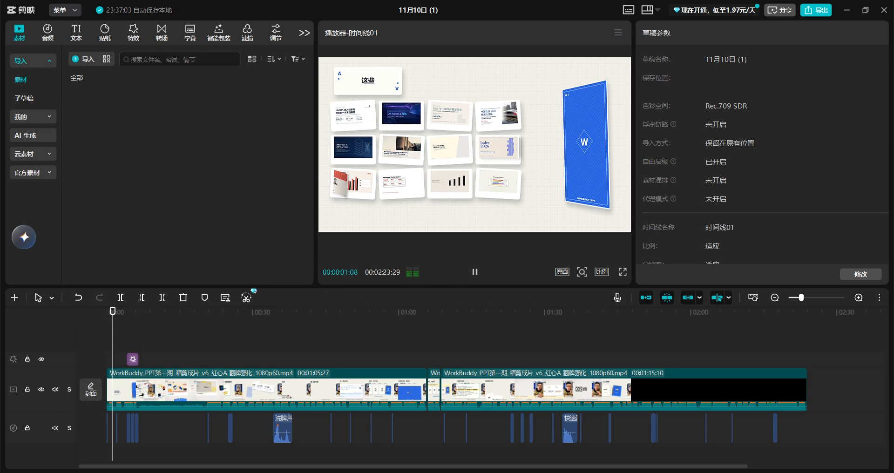

# Swarm Video Skill

**多鼠标蜂群视频剪辑效果。上传一条剪辑好的视频，让多个彩色鼠标光标依次点选，逐步铺开多轨时间线。**

输入视频在播放器内按原比例播放，其他面板来自静态工作区模板。下方 28 个动画光标随点选逐步铺开 11 条轨道。默认按原速、静音、60fps 导出，横版、竖版和方形视频均可输入。



## 安装到智能体

把下面这段话发给你正在用的智能体。

```text
请从 https://github.com/currenttime/swarm-video-skill 安装 swarm-video-skill。
安装到当前智能体的技能目录，保留 SKILL.md、scripts、assets 和 references。
安装后检查所需的 Remotion 技能和运行环境，缺失项先安装，再验证技能可用。
```

也可以在项目目录执行以下命令，按提示选择智能体。要安装到用户级目录，附加 `--global`。

```bash
npx skills add https://github.com/currenttime/swarm-video-skill --skill swarm-video-skill
```

可用 `--agent codex`、`--agent claude-code`、`--agent cursor` 或 `--agent opencode` 指定目标。其他支持 Agent Skills 的客户端也可以下载仓库，把完整技能目录放进客户端配置的技能路径。支持列表和路径见 [Skills CLI 的客户端文档](https://github.com/vercel-labs/skills/blob/main/docs/agents.md)。

安装后上传一条已剪辑视频，对智能体说「使用 swarm-video-skill，把这个视频做成多鼠标蜂群视频剪辑效果。」环境和 Remotion 技能要求见 [前置检查](references/prerequisites.md)。

## 命令行或拖放

首次准备 Python 3.11+、Node.js 22.13+（含 npm）、FFmpeg 和 ffprobe。安装 Python 依赖后，用一条命令运行，也可以在 Windows 上把成片拖到 `make.cmd`。

```bash
python -m pip install -r requirements.txt
python scripts/run.py "成片.mp4"
```

首次安装依赖和 Chromium 需要网络，视频在本机处理。默认生成 1920×1080 演示视频。使用本地截图时，画布采用截图尺寸。成片至少需要 2 秒。

| 可选参数 | 用途 |
|---|---|
| `--template cut` | 剪辑工作区，安装包默认 |
| `--template composite` | 合成工作区，右下保留层面板 |
| `--template color` | 调色工作区，右侧有调色控件和示波区 |
| `--speed 5` | 让播放器和动画按较短的输出时间生成 |
| `--output 新目录` | 指定空输出目录 |
| `--recording` | 处理已经包含真实软件界面的录屏，默认 5 倍速 |
| `--help` | 查看裁取范围、帧率和运行环境等选项 |

三套随仓库提供的模板是原创静态背景。自己的剪映、After Effects 或 DaVinci Resolve 界面截图可以作为替换背景。配置一次后，每次仍只传一个视频。见 [使用自己的界面截图](references/layout.md)。

## 剪映工作区截图

这是作者录制的剪映工作区，已隐去本机保存路径。你可以用这张截图作为背景，让脚本把成片放到播放器区域，在下方生成蜂群动效。



```bash
python scripts/run.py "成片.mp4" --workspace-image docs/jianying-workspace.png --layout docs/jianying-layout.json
```

## 输出

- `swarm-video.mp4` 是带工作区背景和时间线动效的演示视频。
- `project/` 是可编辑的 Remotion 工程。进入目录运行 `npm run dev` 可预览。
- `checks/report.json` 和 `checks/contact-sheet.jpg` 记录检查结果和抽查画面。
- `overlay/` 保留渲染出的透明动效帧。

播放器播放实际成片。下方时间线、波形和鼠标轨迹是为展示效果生成的动画。完整制作过程与重新导出方法见 [制作过程](references/production.md)。测试范围见 [VALIDATION.md](VALIDATION.md)。项目代码采用 MIT，依赖许可见 [THIRD_PARTY_NOTICES.md](THIRD_PARTY_NOTICES.md)。

## 参考与鸣谢

- 多光标协作视觉灵感来自 [DhvanilPatel/swarm-cursors](https://github.com/DhvanilPatel/swarm-cursors)。本项目的轨迹和时间线动效在 Remotion 中渲染。
- 动画渲染使用 [remotion-dev/remotion](https://github.com/remotion-dev/remotion)，制作规则参考 [remotion-dev/skills](https://github.com/remotion-dev/skills)。
- 多智能体安装命令由 [vercel-labs/skills](https://github.com/vercel-labs/skills) 提供。

## 关注 AI 的任意门

| 抖音 | 微信视频号 |
| --- | --- |
|  |  |
